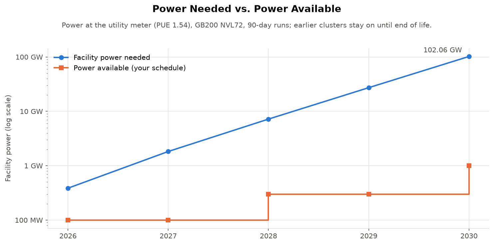
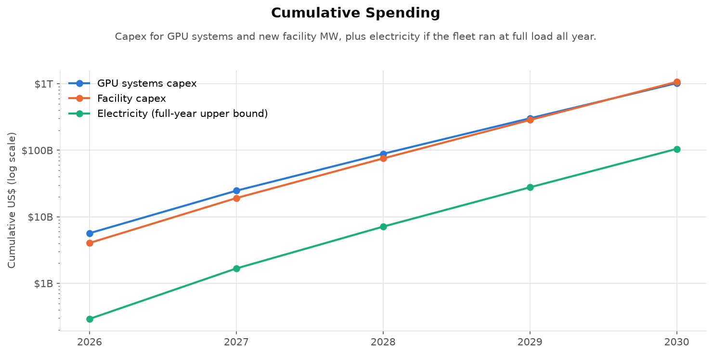
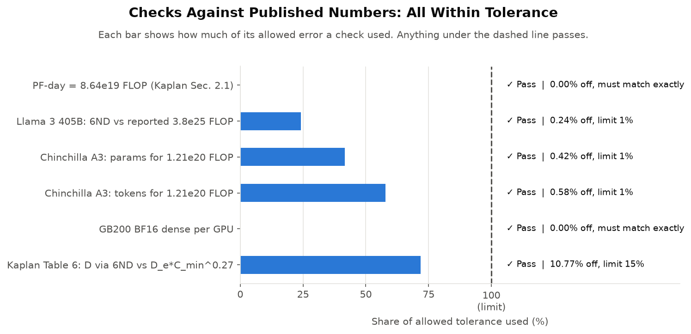

# AI Data Center Scaling Planner

[](https://colab.research.google.com/github/bcurran2/data-center-scaling-planner/blob/main/dc_scaling_planner.ipynb)
[](https://mybinder.org/v2/gh/bcurran2/data-center-scaling-planner/main?labpath=dc_scaling_planner.ipynb)

A Jupyter notebook that converts a planned AI training run (in FLOP) into what a data center planner has to line up: accelerators, IT and facility megawatts, energy, and capital cost. It then lays those out year by year against your power availability, which shows when you need to file for grid interconnection and when you need to start construction.

The notebook is built on the scaling-law papers [Kaplan et al. 2020](https://arxiv.org/abs/2001.08361) and [Hoffmann et al. 2022 ("Chinchilla")](https://arxiv.org/abs/2203.15556). Hardware, facility, and price defaults come from published sources, and each one is cited in the notebook.





The charts above come from the notebook's default example inputs. They show what the method produces and are not a forecast.

## Use it

To view it, open `dc_scaling_planner.ipynb` on GitHub. The outputs are saved in the file.

To run it with your own numbers:

```bash
git clone https://github.com/bcurran2/data-center-scaling-planner.git
cd data-center-scaling-planner
python3 -m venv .venv
source .venv/bin/activate        # Windows PowerShell: .venv\Scripts\Activate.ps1
pip install -r requirements.txt
jupyter notebook dc_scaling_planner.ipynb
```

You can also open the folder in VS Code with the Python and Jupyter extensions and pick `.venv` as the kernel.

1. Edit the **Inputs** cell (Section 3). The values that need your own numbers are `POWER_AVAILABLE_MW`, `TRAINING_DAYS`, `PUE`, and either `TARGET_FLOP_OVERRIDE` or the growth rate.
2. Choose **Run All**. The charts in `images/` are regenerated from your inputs.
3. Read **Section 7**. It re-derives figures that the papers report directly, and it fails loudly if a change breaks the math.

## What's in it

| Section | Output |
|---|---|
| 1 | What the papers say and which parts the planner uses |
| 4 | The calculator: compute → peak FLOP/s → IT MW → facility MW → energy & capex |
| 5 | Year-by-year table: power needed vs. available, shortfall, "file for power by" and "start build by" years, spending, charts |
| 6 | One run in detail, sensitivity to MFU / run length / PUE, and a reality check against Epoch AI's 2030 projection |
| 7 | Checks against published numbers, with a summary chart |
| 8 | Limits and the full source list |

## Validation

Section 7 re-derives numbers the source papers report. Each bar shows how much of its allowed tolerance a check used; anything under 100% passes.



## Caveats

This is a planning calculator, not a forecast. The default run sizes extrapolate a historical trend, and the default power schedule is an example. See Section 8 of the notebook.